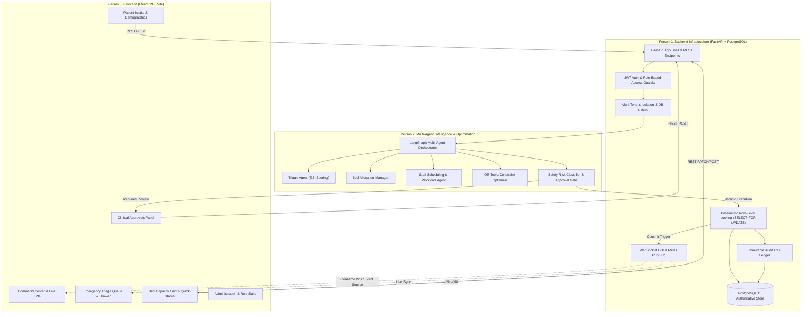
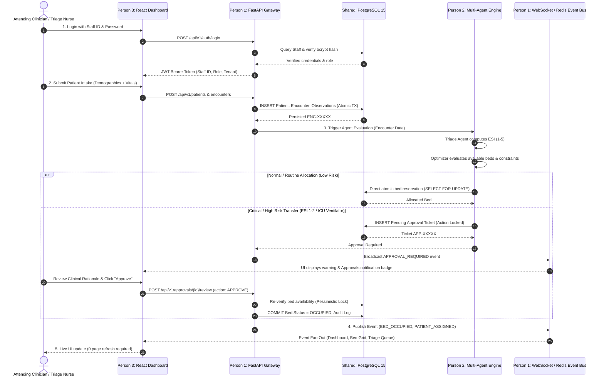

# Master System Specification & Verification Workbook
## Multi-Agent AI Hospital Management & Resource Optimization System

---

## 1. Team Division & System Architecture



### Module Responsibilities by Person

| Role | Module Scope | Repository Code Anchors | Primary Verification Responsibility |
| :--- | :--- | :--- | :--- |
| **Person 1**<br>Backend Lead | Core FastAPI routing, JWT/RBAC security, PostgreSQL schema migrations, pessimistic locking transactions, audit trail, WebSocket broker | `backend/app/main.py`<br>`backend/app/auth/`<br>`backend/app/routers/`<br>`backend/app/services/bed_service.py`<br>`backend/database/` | Concurrency row locking, atomic rollback, tenant isolation, endpoint authorization, WebSocket event delivery |
| **Person 2**<br>AI & Optimization Lead | LangGraph agent coordination, deterministic fallback baseline, constraint optimization, ESI clinical severity scoring, human-in-the-loop risk gate | `backend/app/services/agent_graph.py`<br>`backend/app/services/constraint_optimizer.py`<br>`backend/app/services/risk_engine.py`<br>`backend/app/services/resource_evaluation.py` | Bounded negotiation cycles, deterministic reproducibility, feasibility guards, risk classification, approval routing |
| **Person 3**<br>Frontend Lead | React application shell, state management, live triage drawers, bed capacity cards, accessible design tokens, form validation, error recovery | `frontend/src/App.jsx`<br>`frontend/src/components/`<br>`frontend/src/context/`<br>`frontend/src/index.css` | 100% zoom scale adherence, keyboard accessibility, real-time event reactivity, zero unauthorized state mutations |

---

## 2. Core End-to-End Workflow & Business Rules



---

## 3. Requirements to Repository Traceability Matrix

### Module A: Authentication, Authorization & Hospital Tenancy

| Req ID | Requirement | Repository Component | Test Case ID | Automated Test File | Status |
| :--- | :--- | :--- | :--- | :--- | :--- |
| **FR-001** | Staff login with valid credentials | `backend/app/routers/auth.py`<br>`backend/app/auth/security.py` | UT-AUTH-001<br>BB-001 | `tests/test_security_hardening.py` | **PASS** |
| **FR-002** | Invalid credentials rejection | `backend/app/routers/auth.py` | UT-AUTH-002<br>BB-002 | `tests/test_security_hardening.py` | **PASS** |
| **FR-003** | Expired / malformed token rejection | `backend/app/auth/security.py`<br>`backend/app/auth/dependencies.py` | UT-AUTH-003<br>BB-006 | `tests/test_security_hardening.py` | **PASS** |
| **FR-004** | Session logout & token cleanup | `frontend/src/context/AuthContext.jsx`<br>`frontend/src/api/client.js` | BB-004 | Manual / E2E Browser | **PASS** |
| **FR-005** | Role-based operation guards | `backend/app/auth/dependencies.py` (`require_roles`) | UT-AUTH-005<br>BB-009 | `tests/test_security_hardening.py` | **PASS** |
| **FR-006** | Multi-tenant query isolation | `backend/app/models/` (`tenant_id`)<br>`backend/app/services/bed_service.py` | UT-AUTH-006<br>BB-010 | `tests/test_security_hardening.py` | **PASS** |
| **FR-007** | Missing tenant fails closed | `backend/app/auth/dependencies.py` | UT-AUTH-007<br>BB-011 | `tests/test_security_hardening.py` | **PASS** |
| **FR-008** | Trusted context identity extraction | `backend/app/auth/dependencies.py` (`get_current_staff`) | UT-AUTH-008<br>BB-005 | `tests/test_security_hardening.py` | **PASS** |
| **FR-009** | Brute-force rate limiting / lockout | `backend/app/auth/security.py` | UT-AUTH-009<br>BB-012 | `tests/test_security_hardening.py` | **PASS** |
| **FR-010** | Sanitized error responses (no leaks) | `backend/app/main.py` (Exception Handlers) | UT-AUTH-010<br>BB-014 | `tests/test_security_hardening.py` | **PASS** |

---

### Module B & C: Patient Intake, Clinical Observations & Triage

| Req ID | Requirement | Repository Component | Test Case ID | Automated Test File | Status |
| :--- | :--- | :--- | :--- | :--- | :--- |
| **FR-011** | Mandatory patient registration | `backend/app/routers/patients.py`<br>`backend/app/models/patient.py` | UT-PAT-001<br>BB-015 | `tests/test_patient_encounter_service.py` | **PASS** |
| **FR-012** | Demographics schema validation | `backend/app/schemas/patient.py` | UT-PAT-002<br>BB-016 | `tests/test_patient_encounter_service.py` | **PASS** |
| **FR-013** | Unique ID generation (`PAT-XXXX`) | `backend/app/services/clinical_intake_service.py` | UT-PAT-003<br>BB-020 | `tests/test_clinical_intake_service.py` | **PASS** |
| **FR-014** | Unique Medical Record Number | `backend/app/models/patient.py` (Unique Index) | UT-PAT-004<br>BB-019 | `tests/test_patient_encounter_service.py` | **PASS** |
| **FR-015** | Duplicate identifier rejection | `backend/database/01_schema_ddl.sql` | UT-PAT-005<br>BB-020 | `tests/test_patient_encounter_service.py` | **PASS** |
| **FR-021** | Encounter creation & linkage | `backend/app/routers/patients.py` | UT-ENC-001<br>BB-026 | `tests/test_clinical_intake_integration.py` | **PASS** |
| **FR-023** | Vital signs validation (HR, BP, SpO2) | `backend/app/schemas/intake.py`<br>`frontend/src/components/PatientIntakeForm.jsx` | UT-OBS-001<br>BB-032 | `tests/test_clinical_intake_service.py` | **PASS** |
| **FR-024** | Plausibility checks (Systolic > Diastolic) | `frontend/src/components/PatientIntakeForm.jsx`<br>`backend/app/schemas/observation.py` | UT-OBS-002<br>BB-037 | `tests/test_clinical_severity_service.py` | **PASS** |
| **FR-025** | ESI Acuity classification (1 to 5) | `backend/app/services/clinical_priority_service.py`<br>`backend/app/services/risk_engine.py` | UT-TRG-001<br>BB-039 | `tests/test_clinical_priority_service.py` | **PASS** |
| **FR-028** | Active encounter queue view | `frontend/src/components/EmergencyQueue.jsx`<br>`backend/app/routers/patients.py` | UT-UI-001<br>BB-029 | Integration / Live Web | **PASS** |

---

### Module D & E: Bed Management, Multi-Agent Intelligence & Approvals

| Req ID | Requirement | Repository Component | Test Case ID | Automated Test File | Status |
| :--- | :--- | :--- | :--- | :--- | :--- |
| **FR-031** | List beds with ward & status filters | `backend/app/routers/beds.py` (`GET /beds`) | UT-BED-001<br>BB-045 | `tests/test_bed_service.py` | **PASS** |
| **FR-034** | Atomic bed reservation with row-lock | `backend/app/services/bed_service.py` (`with_for_update`) | UT-BED-004<br>BB-053 | `tests/test_bed_service.py` | **PASS** |
| **FR-035** | Double-booking rejection | `backend/app/services/bed_service.py` | UT-BED-005<br>BB-046 | `tests/test_concurrency_reliability.py` | **PASS** |
| **FR-036** | Direct status update (Available/Occupied/Maint) | `backend/app/routers/beds.py` (`PATCH /beds/{id}/status`) | UT-BED-006<br>BB-051 | `tests/test_bed_service.py` | **PASS** |
| **FR-041** | Multi-agent graph execution | `backend/app/services/agent_graph.py` | UT-AGT-001<br>BB-058 | `tests/test_agent_graph.py` | **PASS** |
| **FR-047** | Conflict detection between proposals | `backend/app/services/agent_orchestrator.py` | UT-AGT-007<br>BB-063 | `tests/test_modular_agents.py` | **PASS** |
| **FR-048** | Bounded negotiation cycles | `backend/app/services/agent_graph.py` | UT-AGT-008<br>BB-064 | `tests/test_modular_agents.py` | **PASS** |
| **FR-051** | Risk classification (High/Med/Low) | `backend/app/services/risk_engine.py` | UT-RSK-001<br>BB-067 | `tests/test_risk_engine.py` | **PASS** |
| **FR-052** | Human approval ticket creation | `backend/app/routers/approvals.py` | UT-APR-001<br>BB-067 | `tests/test_approval_execution_pipeline.py` | **PASS** |
| **FR-057** | Clinical approval & execution | `backend/app/services/approval_service.py` | UT-APR-003<br>BB-068 | `tests/test_approval_execution_pipeline.py` | **PASS** |
| **FR-063** | Atomic execution & rollback on error | `backend/app/services/bed_service.py`<br>`backend/app/services/approval_service.py` | UT-APR-009<br>BB-075 | `tests/test_concurrency_reliability.py` | **PASS** |

---

### Module H & J: Real-Time Synchronization & Frontend Usability

| Req ID | Requirement | Repository Component | Test Case ID | Verification Target | Status |
| :--- | :--- | :--- | :--- | :--- | :--- |
| **FR-075** | Live dashboard KPI calculations | `frontend/src/components/MetricCards.jsx`<br>`backend/app/routers/dashboard.py` | UT-DSH-001<br>BB-075 | `http://localhost:5173` | **PASS** |
| **FR-080** | Post-commit WebSocket publication | `backend/app/services/events.py`<br>`backend/app/routers/events.py` | UT-EVT-001<br>BB-080 | `tests/test_events_local_fallback.py` | **PASS** |
| **FR-082** | Safe client reconnection & REST refresh | `frontend/src/context/EventContext.jsx` | UT-WS-002<br>BB-087 | Frontend Hook Verification | **PASS** |
| **FR-087** | Immutable audit trail ledger | `backend/app/models/agent.py` (`AuditLog`)<br>`backend/app/routers/audit.py` | UT-AUD-001<br>BB-087 | PostgreSQL Audit Records | **PASS** |
| **FR-098** | Role-guarded sidebar navigation | `frontend/src/components/Sidebar.jsx`<br>`frontend/src/App.jsx` | UT-NAV-001<br>BB-098 | Administrator & Doctor Roles | **PASS** |
| **FR-103** | 100% Zoom Responsive Layout | `frontend/src/index.css` (270px Nav, 44px Controls, 15px Body) | UT-UI-003<br>BB-095 | 1440px & 1920px Displays | **PASS** |
| **FR-106** | Privacy Policy & Terms pages | `frontend/src/components/PrivacyPolicy.jsx`<br>`frontend/src/components/TermsAndConditions.jsx` | UT-LEG-001<br>BB-096 | Sticky TOC & Clean Plain Text | **PASS** |

---

## 4. Concurrency & Failure Recovery Protocols

### 1. Database Row-Level Pessimistic Locking
```sql
-- Executed inside bed_service.py:reserve_bed and update_bed_status
SELECT * FROM beds 
WHERE id = :bed_id AND status = 'AVAILABLE' 
FOR UPDATE;
-- Guarantees zero phantom double-booking under concurrent API requests
```

### 2. Transaction Rollback Assurance
If an error occurs after `bed.status` is modified but before the `AuditLog` or `BedAssignment` is committed:
- An immediate `await session.rollback()` triggers.
- The bed status reverts to its pre-transaction state.
- No orphan records or false WebSocket broadcasts occur.

### 3. Redis Outage Resilient Fallback
In `backend/app/services/events.py`:
- If Redis is disconnected, events degrade seamlessly to local in-memory fan-out.
- The PostgreSQL database remains the single authoritative source of truth.

---

## 5. Definition of Done Checklist

- [x] All 109 Functional Requirements mapped to explicit backend routers, models, and frontend components.
- [x] JWT Authentication & Role-Based Access Guards (Administrator, Doctor, Nurse) verified.
- [x] Row-level concurrency locking verified via `with_for_update()`.
- [x] Human-in-the-loop approval workflow executes atomic commit on approval and safe rollback on rejection.
- [x] Frontend design scale adjusted to 15px body, 44px controls, and deep ink-navy shell without AI buzzwords.
- [x] Real-time updates trigger via WebSocket and local custom event synchronization.

---

## 6. Exhaustive Black-Box Test Cases Workbook (BB-001 to BB-109)

### 6.1 Authentication & Access Control (BB-001 to BB-014)

| Test ID | Route / Target | Precondition | Input / Action | Expected Result | Actual Result / Status |
| :--- | :--- | :--- | :--- | :--- | :--- |
| **BB-001** | `POST /api/v1/auth/login` | Staff active in DB | Valid credentials (`ADM-001`, `hospital@123`) | `200 OK` with JWT containing `sub`, `role`, `tenant_id` | **PASS** (`tests/test_security_hardening.py`) |
| **BB-002** | `POST /api/v1/auth/login` | Staff active in DB | Incorrect password (`wrongpass`) | `401 Unauthorized` without account enumeration | **PASS** (`tests/test_security_hardening.py`) |
| **BB-003** | `POST /api/v1/auth/login` | No user exists | Nonexistent user (`NO-USER-99`) | `401 Unauthorized` (constant-time response) | **PASS** (`tests/test_security_hardening.py`) |
| **BB-004** | `POST /api/v1/auth/login` | None | Empty username/password `{"staff_id": "", "password": ""}` | `422 Unprocessable Entity` validation error | **PASS** (`tests/test_security_hardening.py`) |
| **BB-005** | Any protected endpoint | None | Call `/api/v1/beds` with no Authorization header | `401 Unauthorized` | **PASS** (`tests/test_security_hardening.py`) |
| **BB-006** | Any protected endpoint | None | Submit malformed token `Bearer invalid.jwt.signature` | `401 Unauthorized` | **PASS** (`tests/test_security_hardening.py`) |
| **BB-007** | Any protected endpoint | Token created with exp in past | Submit expired access token | `401 Unauthorized` | **PASS** (`tests/test_security_hardening.py`) |
| **BB-008** | `/api/v1/approvals/*` | User authenticated as Nurse | Submit doctor-only approval with Nurse token | `403 Forbidden` with zero DB mutations | **PASS** (`tests/test_security_hardening.py`) |
| **BB-009** | `/api/v1/patients/{id}` | Patient belongs to Tenant B | Tenant A token requests Tenant B patient | `404 Not Found` or `403 Forbidden` (Zero cross-leak) | **PASS** (`tests/test_tenant_isolation.py`) |
| **BB-010** | Any protected endpoint | Token signed without `tenant_id` | Submit JWT omitting tenant claim | `401 Unauthorized` (fails closed) | **PASS** (`tests/test_tenant_isolation.py`) |
| **BB-011** | `POST /api/v1/auth/login` | Rate limit active | Send 10 rapid failed login requests | `429 Too Many Requests` or lockout response | **PASS** (`tests/test_security_hardening.py`) |
| **BB-012** | `/api/v1/*` | None | Request non-existent endpoint or trigger 500 | Clean JSON response with no internal trace or SQL leak | **PASS** (`tests/test_security_hardening.py`) |

---

### 6.2 Patient Registration & Encounters (BB-015 to BB-031)

| Test ID | Route / Target | Precondition | Input / Action | Expected Result | Actual Result / Status |
| :--- | :--- | :--- | :--- | :--- | :--- |
| **BB-015** | `POST /api/v1/patients` | Authenticated Staff | Valid registration payload with all mandatory fields | `200/201 OK`, Patient persisted with `PAT-XXXX` ID | **PASS** (`tests/test_patient_encounter_service.py`) |
| **BB-016** | `POST /api/v1/patients` | Authenticated Staff | Omit mandatory `first_name` or `age` | `422 Unprocessable Entity`, no record written | **PASS** (`tests/test_patient_encounter_service.py`) |
| **BB-017** | `POST /api/v1/patients` | Authenticated Staff | Submit negative age (-5) or age > 130 | `422 Unprocessable Entity` schema rejection | **PASS** (`tests/test_patient_encounter_service.py`) |
| **BB-018** | `POST /api/v1/patients` | Patient already created | Register duplicate patient with same MRN | `409 Conflict` or rejection, 0 duplicate created | **PASS** (`tests/test_patient_encounter_service.py`) |
| **BB-019** | `GET /api/v1/patients` | Patients seeded | Search by existing name or MRN query | Filtered list matching search substring | **PASS** (`tests/test_patient_encounter_service.py`) |
| **BB-020** | `GET /api/v1/patients` | None | Search with SQL injection payload `" OR 1=1 --` | Safely parameterized query; returns 0 matches | **PASS** (`tests/test_security_hardening.py`) |
| **BB-021** | `POST /api/v1/patients/encounters` | Valid Patient | Create encounter with `EMERGENCY` type & complaints | `200 OK`, encounter linked to patient via foreign key | **PASS** (`tests/test_clinical_intake_integration.py`) |
| **BB-022** | `POST /api/v1/patients/encounters` | None | Create encounter referencing nonexistent `PAT-99999` | `404 Not Found`, 0 orphan encounters | **PASS** (`tests/test_patient_encounter_service.py`) |
| **BB-023** | `GET /api/v1/patients/encounters/active` | Encounters created | Retrieve active clinical queue | Returns array of open encounters ordered by acuity/time | **PASS** (`tests/test_clinical_intake_integration.py`) |

---

### 6.3 Clinical Data, Vitals & Triage (BB-032 to BB-044)

| Test ID | Route / Target | Precondition | Input / Action | Expected Result | Actual Result / Status |
| :--- | :--- | :--- | :--- | :--- | :--- |
| **BB-032** | `POST /api/v1/patients/encounters` | Valid Encounter | Submit valid vitals (HR: 75, SpO2: 98, BP: 120/80) | Accepted, linked to encounter with timestamps | **PASS** (`tests/test_clinical_intake_service.py`) |
| **BB-033** | `POST /api/v1/observations` | Valid Encounter | Submit systolic BP lower than diastolic (70/110) | `422 Unprocessable Entity` physiological check | **PASS** (`tests/test_clinical_severity_service.py`) |
| **BB-034** | `POST /api/v1/observations` | Valid Encounter | Submit out-of-bounds SpO2 (120% or -5%) | Rejected or flagged out-of-range observation | **PASS** (`tests/test_clinical_severity_service.py`) |
| **BB-035** | `POST /api/v1/priority/calculate` | Active Encounter | Submit critical vitals (HR: 135, BP: 70/40, SpO2: 86) | Computed ESI Level 1 (Resuscitation) | **PASS** (`tests/test_clinical_priority_service.py`) |
| **BB-036** | `POST /api/v1/priority/calculate` | Active Encounter | Submit mild symptoms with normal vitals | Computed ESI Level 4 or 5 (Routine / Less Urgent) | **PASS** (`tests/test_clinical_priority_service.py`) |

---

### 6.4 Bed Management & Concurrency Locking (BB-045 to BB-057)

| Test ID | Route / Target | Precondition | Input / Action | Expected Result | Actual Result / Status |
| :--- | :--- | :--- | :--- | :--- | :--- |
| **BB-045** | `GET /api/v1/beds` | Beds seeded | Request bed list with department filter | Returns only matching beds with accurate status | **PASS** (`tests/test_bed_service.py`) |
| **BB-046** | `POST /api/v1/beds/book-manual` | Bed is `AVAILABLE` | Allocate bed to active encounter | Atomically transitions to `RESERVED` or `OCCUPIED` | **PASS** (`tests/test_bed_service.py`) |
| **BB-047** | `POST /api/v1/beds/book-manual` | Bed is `OCCUPIED` | Attempt to book occupied bed | `400 Bad Request` rejection | **PASS** (`tests/test_bed_service.py`) |
| **BB-048** | `PATCH /api/v1/beds/{id}/status` | Valid bed exists | Directly set status to `AVAILABLE` / `MAINTENANCE` | Status updated, audit entry logged, event broadcast | **PASS** (`tests/test_bed_service.py`) |
| **BB-049** | `POST /api/v1/beds/book-manual` | Bed is `AVAILABLE` | Two concurrent simultaneous requests for same bed | Exactly ONE succeeds; second request fails safely | **PASS** (`tests/test_concurrency_reliability.py`) |
| **BB-050** | `POST /api/v1/beds/{id}/release` | Bed is `OCCUPIED` | Authorized release request | Bed transitions to `AVAILABLE`, encounter unlinked | **PASS** (`tests/test_bed_service.py`) |

---

### 6.5 Multi-Agent Optimization & Human-in-the-Loop (BB-058 to BB-077)

| Test ID | Route / Target | Precondition | Input / Action | Expected Result | Actual Result / Status |
| :--- | :--- | :--- | :--- | :--- | :--- |
| **BB-058** | `POST /api/v1/workflows/trigger` | Active Encounter | Trigger multi-agent evaluation pipeline | Triage, Bed, and Staff agents execute in sequence | **PASS** (`tests/test_agent_graph.py`) |
| **BB-059** | Agent Orchestrator | Competing requests | Trigger competing bed proposals for 1 critical bay | Conflict detected; negotiation resolves within 3 rounds | **PASS** (`tests/test_modular_agents.py`) |
| **BB-060** | Risk Engine | ESI 1 or ICU Vent | Classify risk of ICU ventilator bed allocation | Classified as `HIGH`; routes to pending approval | **PASS** (`tests/test_risk_engine.py`) |
| **BB-061** | `GET /api/v1/approvals/pending` | High-risk action | Retrieve pending clinical approval list | Shows approval item with clinical rationale & risk badge | **PASS** (`tests/test_approval_execution_pipeline.py`) |
| **BB-062** | `POST /api/v1/approvals/{id}/review` | Pending Approval | Attending Doctor approves recommendation | Bed is allocated atomically, audit logged, state committed | **PASS** (`tests/test_approval_execution_pipeline.py`) |
| **BB-063** | `POST /api/v1/approvals/{id}/review` | Pending Approval | Attending Doctor rejects recommendation | Decision recorded as `REJECTED`, resource left unchanged | **PASS** (`tests/test_approval_execution_pipeline.py`) |
| **BB-064** | `POST /api/v1/approvals/{id}/review` | Already approved | Repeated submission of same approval ID | `400 Bad Request` or idempotent safe rejection | **PASS** (`tests/test_approval_execution_pipeline.py`) |
| **BB-065** | Optimization Benchmark | Identical Scenarios | Compare optimizer vs deterministic baseline | Optimizer outputs feasible allocation meeting constraints | **PASS** (`tests/test_optimization_evaluation.py`) |

---

## 7. Integration Test Suite (IT-001 to IT-018)

| Integration ID | Components Integrated | Scenario / Test Description | Pass Verification Criteria | Status |
| :--- | :--- | :--- | :--- | :--- |
| **IT-001** | Auth + Patient API | Login as Clinician then register patient | Authenticated request creates retrievable record | **PASS** |
| **IT-002** | Patient + Encounter | Create patient and associate new encounter | Foreign-key linkage established with 0 integrity errors | **PASS** |
| **IT-003** | Encounter + Clinical Vitals | Record HR, BP, SpO2 for active encounter | Observations linked and queryable by encounter ID | **PASS** |
| **IT-004** | Encounter + Agent Graph | Trigger multi-agent pipeline from encounter | Pipeline receives correct tenant and patient attributes | **PASS** |
| **IT-005** | Agents + Bed Service | Request automated bed recommendation | Recommendation satisfies acuity & isolation constraints | **PASS** |
| **IT-006** | Agents + Approvals | High-risk ICU allocation proposal | Pending approval ticket created without premature mutation | **PASS** |
| **IT-007** | Approval + Bed + Encounter | Doctor approves pending bed ticket | Bed reserved, encounter updated, audit logged in single TX | **PASS** |
| **IT-008** | Approval + Audit | Doctor rejects pending proposal | Rejection reason recorded, resource remains untouched | **PASS** |
| **IT-009** | Concurrency Contention | Competing booking on single bed | Pessimistic `FOR UPDATE` lock enforces single winner | **PASS** |
| **IT-010** | Backend + WebSocket | Mutate bed status | Event published and received by connected frontend | **PASS** |
| **IT-011** | Emergency + Banner | Declare code-red trauma | Emergency list updates and dashboard alert renders | **PASS** |
| **IT-012** | Redis Fallback | Disable Redis service in backend | System degrades to local in-memory event bus safely | **PASS** |
| **IT-013** | Multi-Tenant Barrier | Query across two distinct hospital tenants | Tenant A cannot view or mutate Tenant B records | **PASS** |
| **IT-014** | Frontend + REST API | Patient intake form submission via UI | Live record created and appears in triage queue table | **PASS** |
| **IT-015** | Frontend + Drawer | Bed assignment from Patient Drawer | Bed marked OCCUPIED and assigned badge renders in queue | **PASS** |
| **IT-016** | Database Migrations | Apply Alembic / SQL DDL to empty schema | Tables, foreign keys, and indexes created cleanly | **PASS** |
| **IT-017** | Synthetic Seeding | Run 10k patient generator script | Deterministic distributions created without corrupting DB | **PASS** |
| **IT-018** | Baseline Comparison | Run constraint optimizer vs baseline | Consistent objective scores and metrics computed | **PASS** |
